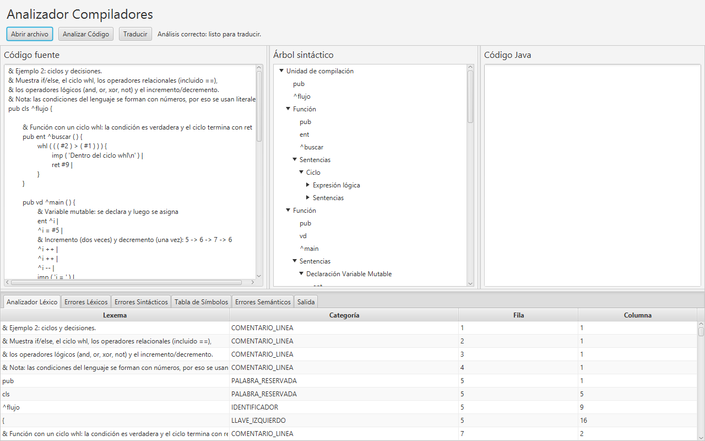
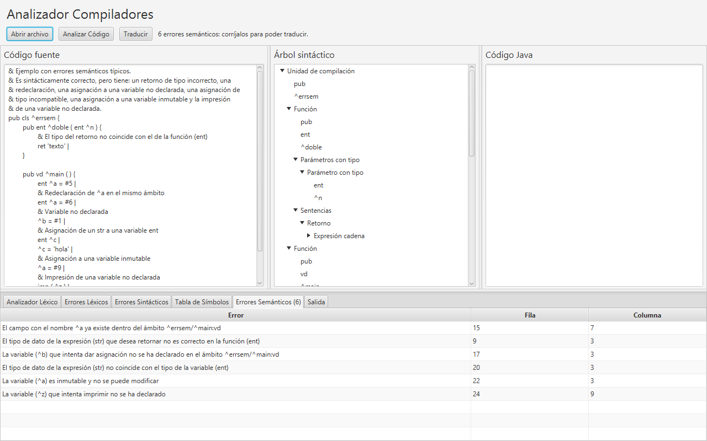
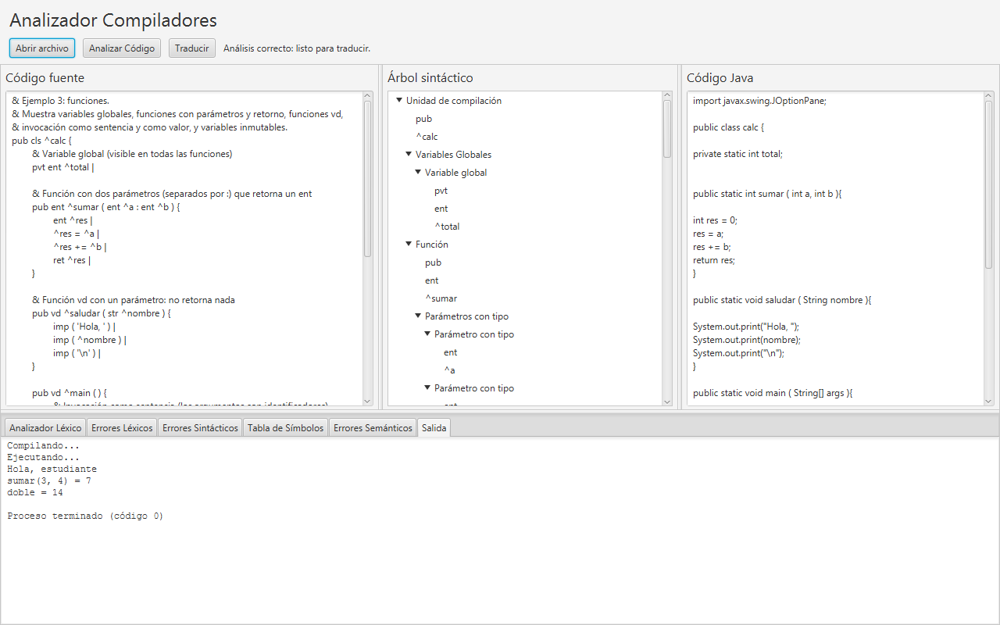

# Compilador del lenguaje del curso de Compiladores (Kotlin + JavaFX)

Compilador escrito en **Kotlin** que analiza un lenguaje propio, definido en el curso de **Compiladores** de la **Universidad del Quindío**, y lo **traduce a Java**. El programa traducido se compila y se ejecuta desde la propia aplicación, que muestra el resultado en una interfaz gráfica JavaFX.

**Autores** (según la portada de la especificación léxica del curso):

- Cristian Fabian Bastidas Obregon
- Jessica Quintero Valencia
- Andrés Mauricio Hernández P.

## Ejemplo

Programa en el lenguaje del curso (`ejemplos/01-hola-mundo.txt`, sin los comentarios iniciales del archivo):

```text
pub cls ^holaMundo {
	pub vd ^main ( ) {
		imp ( 'Hola mundo\n' ) |
		imp ( 'Mi primer programa compilado a Java\n' ) |
	}
}
```

Java que genera el compilador (salida real de `UnidadDeCompilacion.getCodeJava()`):

```java
import javax.swing.JOptionPane;

public class holaMundo {


public static void main ( String[] args ){

System.out.print("Hola mundo\n");
System.out.print("Mi primer programa compilado a Java\n");
}

}
```

## Características

El compilador trabaja en fases encadenadas:

1. **Análisis léxico**: convierte el texto en tokens (25 categorías) y reporta los símbolos desconocidos sin detenerse.
2. **Análisis sintáctico**: descenso recursivo con retroceso; construye el árbol sintáctico (AST) y reporta el error más lejano.
3. **Análisis semántico**: llena la tabla de símbolos por ámbitos y comprueba tipos, declaraciones y mutabilidad.
4. **Traducción a Java**: genera una clase Java a partir del AST.
5. **Compilación y ejecución**: compila con `javax.tools` y ejecuta en un proceso aparte, con límite de 10 s.

La interfaz tiene:

- **Código fuente** (editable), **Árbol sintáctico** y **Código Java** generado.
- Pestañas de resultados: **Analizador Léxico** (tokens), **Errores Léxicos**, **Errores Sintácticos**, **Tabla de Símbolos**, **Errores Semánticos** y **Salida** (compilación y ejecución del programa). Las pestañas de errores muestran el número de errores entre paréntesis y se seleccionan solas cuando hay fallos.
- Botones **Abrir archivo**, **Analizar Código** y **Traducir**.
- **Barra de estado** con el resultado de la última acción.

### Capturas

<!--
Pendiente: el autor debe tomar estas capturas de la aplicación en ejecución, guardarlas en docs/img/
(interfaz.png, errores.png, traduccion.png) y descomentar este bloque.






-->

## Requisitos

- **JDK 17** (con `javac`; un JRE no basta, porque la aplicación compila el Java generado).
- **Maven 3.9+**.
- JavaFX **no** hace falta instalarlo: Maven descarga OpenJFX 21 como dependencia, así que sirve cualquier JDK 17 sin JavaFX.

> **Aviso:** si la variable `JAVA_HOME` apunta a otro JDK (por ejemplo, el 8), Maven fallará. Ejecute los comandos indicando el JDK 17.
>
> PowerShell:
>
> ```powershell
> $env:JAVA_HOME = "C:\Program Files\Eclipse Adoptium\jdk-17.0.20.101-hotspot"; mvn javafx:run
> ```
>
> Bash (Git Bash, Linux, macOS):
>
> ```bash
> JAVA_HOME="/ruta/al/jdk-17" mvn javafx:run
> ```

## Cómo ejecutar

Recuerde usar un JDK 17 en `JAVA_HOME` (ver [Requisitos](#requisitos)).

```bash
mvn javafx:run
```

### Pruebas

```bash
mvn test
```

Hay **179 pruebas** unitarias y de integración (léxico, sintáctico, semántico, traducción a Java y los archivos de `ejemplos/`). Las de traducción compilan y ejecutan programas reales, por lo que necesitan un JDK.

### Ejecutable (.jar)

Se puede empaquetar la aplicación completa (con Kotlin y OpenJFX incluidos) en un único `.jar` ejecutable:

```bash
JAVA_HOME="/ruta/al/jdk-17" mvn clean package
```

El archivo queda en `target/compilador-1.0.0-SNAPSHOT.jar` (unos 11 MB). `maven-shade-plugin` reemplaza el jar principal; el original sin dependencias se conserva como `target/original-compilador-1.0.0-SNAPSHOT.jar`. Para ejecutarlo:

```bash
java -jar target/compilador-1.0.0-SNAPSHOT.jar
```

También funciona con doble clic si los `.jar` están asociados a un JDK 17.

- **Requiere un JDK 17, no un JRE**: el botón **Traducir** compila el Java generado en tiempo de ejecución con `javax.tools`, que solo existe en un JDK.
- La clase principal del manifiesto es `Lanzador`, que no extiende `Application` (JavaFX lo exige cuando se carga desde el classpath). `mvn javafx:run` sigue usando `Aplicacion`. Al arrancar aparece una advertencia de JavaFX ("Unsupported JavaFX configuration") que es inofensiva.
- **Es específico de la plataforma**: las dependencias de OpenJFX llevan un clasificador por sistema operativo (por ejemplo `win`), así que el jar solo funciona en el sistema donde se construyó. Para otra plataforma, ejecute `mvn clean package` en ese sistema: Maven resuelve el clasificador correspondiente.

### IntelliJ IDEA

Abra la carpeta con *File > Open*, elija el `pom.xml` e impórtelo como **proyecto Maven** con **JDK 17**. Para ejecutar, use la clase `co.edu.uniquindio.compiladores.app.Aplicacion` o el objetivo Maven `javafx:run`.

## Uso paso a paso

1. Inicie la aplicación con `mvn javafx:run`.
2. Pulse **Abrir archivo** y elija un programa de la carpeta `ejemplos/` (o escriba uno en el área *Código fuente*).
3. Pulse **Analizar Código**. Si hay errores, la pestaña correspondiente se selecciona y su título muestra cuántos hay. Si no los hay, la barra de estado indica "Análisis correcto: listo para traducir.".
4. Revise los tokens, el árbol sintáctico y la tabla de símbolos.
5. Pulse **Traducir**: se muestra el Java generado, se compila y se ejecuta; la pestaña **Salida** muestra el resultado.
6. Si edita el código, vuelva a analizar: el análisis anterior deja de ser válido.

| Archivo | Qué muestra |
| --- | --- |
| `ejemplos/01-hola-mundo.txt` | Estructura mínima: una clase con `^main` de tipo `vd` que imprime con `imp`. |
| `ejemplos/02-ciclos-y-decisiones.txt` | `if`/`else`, ciclo `whl`, operadores relacionales y lógicos, incremento y decremento. |
| `ejemplos/03-funciones.txt` | Variables globales, funciones con parámetros y retorno, invocación como sentencia y como valor, variables inmutables. |
| `ejemplos/04-lectura.txt` | Lectura con `rad` (diálogos de entrada) asignada a `str`, `ent` y `dbe`. |
| `ejemplos/error-lexico.txt` | Símbolos desconocidos (`$`, `~`) reportados por el léxico. |
| `ejemplos/error-sintactico.txt` | Falta el terminador `\|` en una declaración. |
| `ejemplos/error-semantico.txt` | Retorno de tipo incorrecto, redeclaración, variable no declarada, tipos incompatibles, asignación a una variable inmutable e impresión de una variable no declarada. |

## Estructura del proyecto

```text
Analisador_Lexico_Compiladores/
├── pom.xml                      Configuración de Maven (Kotlin, OpenJFX 21, JUnit 5)
├── README.md                    Este archivo
├── src/co/edu/uniquindio/compiladores/
│   ├── app/                     Aplicacion (JavaFX) y Lanzador (Main-Class del .jar)
│   ├── controlador/             InicioController: lógica de la interfaz y ejecución
│   ├── lexico/                  AnalizadorLexico, Token, Categoria, Error
│   ├── sintaxis/                AnalizadorSintactico, nodos del AST y CodigoJava
│   └── semantico/               AnalizadorSemantico, TablaSimbolos, Simbolo
├── resources/                   inicio.fxml: diseño de la interfaz
├── test/co/edu/uniquindio/compiladores/   Pruebas unitarias por fase y de los ejemplos
├── ejemplos/                    Programas de ejemplo del lenguaje (.txt)
└── docs/                        Documentación del lenguaje, la gramática, la traducción y la arquitectura
```

## Documentación

- [Lenguaje](docs/lenguaje.md)
- [Gramática](docs/gramatica.md)
- [Traducción a Java](docs/traduccion.md)
- [Arquitectura](docs/arquitectura.md)

## Limitaciones conocidas

Son decisiones del diseño original del lenguaje, no errores del compilador:

- Las expresiones aritméticas y relacionales solo admiten **literales numéricos**: no se puede comparar una variable.
- Las condiciones de `if` y `whl` van entre **tres paréntesis**, por ejemplo `( ( ( #1 ) > ( #2 ) ) )`.
- Los argumentos de una invocación de función deben ser **identificadores** (variables o parámetros), no literales.
- La concatenación de cadenas con `+` solo admite **literales** (cadenas, caracteres y números), no variables.
- `imp` **no añade salto de línea**: hay que escribir `\n` dentro de la cadena.
- El analizador sintáctico informa **un solo error** por programa (el más lejano que alcanzó).
- `rad` solo se puede asignar a variables `str`, `ent` o `dbe`. Si el usuario **cancela el diálogo** y la variable es `ent` o `dbe`, el programa ejecutado lanza una excepción (en una `str` queda en `null`).
- Hay **palabras reservadas sin uso** en la gramática: `abs` (abstract), `brk` (break), `cas` (case), `cth` (catch), `ptt` (protected), `cat`, `array`, `mut`, `inm`, `tre` y `fls`. El analizador léxico las reconoce, pero el sintáctico no las acepta en ninguna construcción (por ejemplo, no existen literales booleanos). La mutabilidad se decide por la forma de la declaración: `ent ^a |` es modificable y `ent ^a = #1 |` es inmutable.
- No se comprueba que una variable se declare **antes** de usarla dentro del mismo ámbito: `^b = #1 |` antes de `ent ^b |` pasa el análisis, pero el Java generado no compila.
- Dos funciones con el mismo nombre y tipo de retorno, pero con distintos tipos de parámetros, no pueden reutilizar los nombres de sus parámetros: el ámbito de la función es `^clase/^nombre:tipo` (sin los tipos de los parámetros) y se reporta "El campo con el nombre ... ya existe dentro del ámbito ...".

## Licencia

Este proyecto se distribuye bajo la [licencia MIT](LICENSE).
