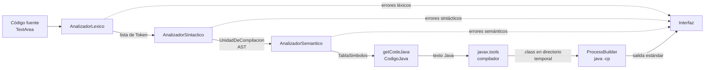
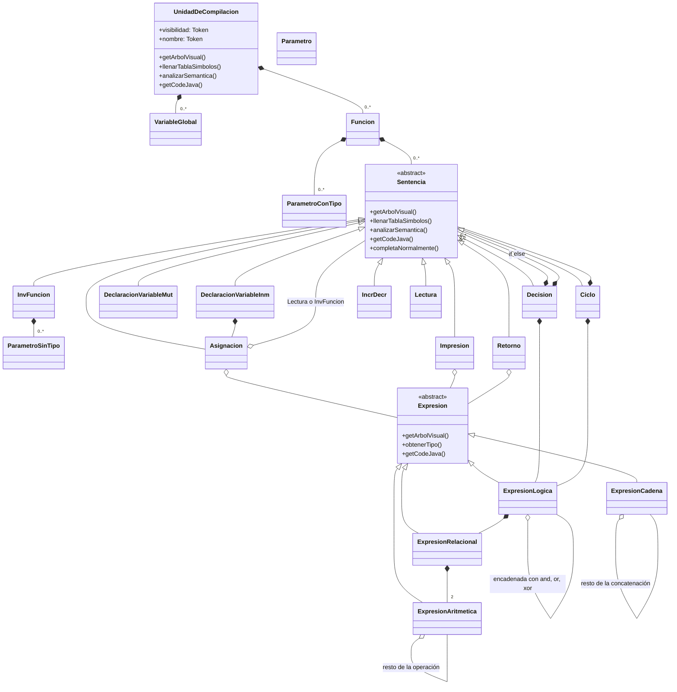

# Arquitectura

Este documento describe cómo está organizado el compilador: las fases, los paquetes, las clases clave, el manejo del retroceso en el análisis sintáctico, los ámbitos de la tabla de símbolos y el flujo de traducción y ejecución.

Ver también: [lenguaje](lenguaje.md), [gramática](gramatica.md) y [traducción a Java](traduccion.md).

## Diagrama de fases

El controlador detiene la cadena en cuanto una fase produce errores: si hay errores léxicos o sintácticos no se ejecuta el análisis semántico, y si hay errores semánticos no se puede traducir. El botón **Traducir** solo actúa sobre un análisis completo y sin errores.

## Diagrama de clases del AST

Las clases viven en el paquete `sintaxis`. Todas las sentencias heredan de `Sentencia` y todas las expresiones de `Expresion`. `Funcion`, `VariableGlobal` y los parámetros no son sentencias ni expresiones. `Parametro` existe en el código pero ninguna otra clase la usa (el analizador crea `ParametroConTipo` y `ParametroSinTipo`).

Las relaciones marcadas con rombo vacío (`o--`) son opcionales (pueden ser nulas). `Asignacion` recibe como valor una `Expresion`, o bien una `Lectura` (`rad`) o una `InvFuncion`, o bien otro identificador.

Cada nodo del AST implementa las tres operaciones que recorren el árbol: `llenarTablaSimbolos` (primera pasada), `analizarSemantica` (segunda pasada) y `getCodeJava` (traducción), además de `getArbolVisual` (el `TreeItem` que dibuja el árbol en la interfaz).

## Paquetes

| Paquete | Responsabilidad |
| --- | --- |
| `app` | Punto de entrada: `Aplicacion` carga `inicio.fxml` y abre la ventana. |
| `controlador` | `InicioController` conecta la interfaz con las fases y gestiona la compilación y ejecución. |
| `lexico` | Convierte el texto en tokens: `AnalizadorLexico`, `Token`, `Categoria`, `Error`. |
| `sintaxis` | Análisis sintáctico (`AnalizadorSintactico`), nodos del AST y `CodigoJava` (utilidades de traducción). |
| `semantico` | `AnalizadorSemantico`, `TablaSimbolos` y `Simbolo`. |

Fuera de `src/`: `resources/inicio.fxml` (diseño de la interfaz), `test/` (pruebas), `ejemplos/` (programas de muestra).

## Clases clave

### Paquete `lexico`

- **`AnalizadorLexico(codigoFuente)`**: recorre el texto carácter a carácter. `analizar()` llena `listaTokens` y `listaErrores`. Salta los espacios y prueba, en este orden, cada tipo de token: palabras reservadas, enteros, decimales, identificadores, operadores lógicos, incremento, decremento, relacionales, de asignación y aritméticos, paréntesis, llaves, corchetes, fin de sentencia, punto, dos puntos, separador, comentario de línea, comentario de bloque, carácter y cadena y, si ninguno aplica, genera un token `DESCONOCIDO` y un error, para poder seguir con el resto del programa. Mantiene las listas de palabras reservadas y de operadores lógicos (`not`, `or`, `xor`, `and`).
- **`Token(lexema, categoria, fila, columna)`**: unidad léxica con su posición.
- **`Categoria`**: enumeración de los 25 tipos de token (`PALABRA_RESERVADA`, `ENTERO`, `DECIMAL`, `IDENTIFICADOR`, operadores, delimitadores, comentarios, `CADENA_CARACTERES`, `CARACTER`, `DESCONOCIDO`, etc.).
- **`Error(error, fila, columna)`**: mensaje con posición; lo usan las tres fases para sus errores.

### Paquete `sintaxis`

- **`AnalizadorSintactico(listaTokens)`**: analizador de descenso recursivo. Cada regla de la gramática es un método `esXxx()` que devuelve el nodo del AST o `null`. El punto de entrada es `esUnidadDeCompilacion()`.
- **`UnidadDeCompilacion`**: raíz del AST (la clase: visibilidad, nombre, variables globales y funciones). Es quien orquesta las pasadas semánticas y la generación de Java (`getCodeJava()` produce el archivo completo, con `import javax.swing.JOptionPane;` para `rad`).
- **`CodigoJava`** (objeto singleton): utilidades compartidas por la traducción: nombres de identificadores seguros (evita palabras reservadas de Java), renombrado de variables locales para evitar sombreado, conversión de literales (números, cadenas, caracteres), tipos y visibilidad, y encadenado de sentencias omitiendo el código inalcanzable.

### Paquete `semantico`

- **`AnalizadorSemantico(uc)`**: fachada con dos pasos que deben llamarse en orden: `llenarTablaSimbolos()` y `analizarSemantica()`. Guarda `tablaSimbolos` y `listaErroresSemanticos`.
- **`TablaSimbolos`**: lista de `Simbolo`. Guarda y busca valores (variables, parámetros) y funciones, y reporta duplicados.
- **`Simbolo`**: nombre, tipo, modificable, ámbito, acceso, fila, columna y, si es una función, `tiposParametros`.

### Paquetes `controlador` y `app`

- **`InicioController`**: controlador del FXML. Atiende los tres botones, llena las tablas, selecciona la pestaña con errores y actualiza la barra de estado. Contiene además el flujo de compilación y ejecución (ver más abajo).
- **`Aplicacion`**: subclase de `javafx.application.Application`; carga `/inicio.fxml`, crea la escena con el título "Mi compilador" y la muestra. Su `main` llama a `launch`.

## Retroceso y "error más lejano" en el sintáctico

La gramática es ambigua al inicio de una sentencia (por ejemplo, `ent ^a |` y `ent ^a = #1 |` empiezan igual, y un identificador puede iniciar una asignación, una invocación o un incremento). Por eso `esSentencia()` prueba las alternativas en orden hasta que una devuelve un nodo.

**Retroceso.** Cada regla guarda al inicio la posición del token (`posicionActual`) y la cantidad de errores (`listaErrores.size`). Si la alternativa falla, llama a `restablecerToken(posicionInicial, erroresIniciales)`, que reposiciona el analizador y descarta los errores acumulados desde ese punto, porque eran especulativos (producidos al probar una alternativa que se abandona).

**Error más lejano.** Descartar errores deja la lista vacía aunque el programa sea incorrecto. Para explicar el fallo, `reportarError` recuerda aparte (`falloMasLejano` y `posicionFalloMasLejano`) el error ocurrido en la posición de token más avanzada, incluidos los de alternativas descartadas. Cuando una regla de nivel superior (`esUnidadDeCompilacion`) debe fallar, usa `reportarErrorFinal`: si el error más lejano está más adelante que la posición actual, informa ese (es el que realmente explica el problema) y no el mensaje genérico, como "Falta la llave derecha".

Detalles:

- Un error se puede reportar con `candidato = false`: se lista, pero no compite como más lejano. En un empate de posición gana el primero que se reportó.
- No se guardan errores repetidos (mismo mensaje y misma posición).
- Los comentarios se saltan al avanzar de token.
- Si se agotan los tokens, el token actual es un fin de archivo sintético situado justo tras el último token.
- Tras cerrar la llave de la clase, si queda código se informa "Hay código después de la llave que cierra la clase".

Por esta razón el analizador informa, en la práctica, un solo error sintáctico por programa.

## Ámbitos de la tabla de símbolos

El ámbito de un símbolo es una cadena con barras que describe dónde se declaró:

| Ámbito | Contiene |
| --- | --- |
| `^clase` | Variables globales y las funciones de la clase. |
| `^clase/^funcion:tipo` | Parámetros y variables locales de la función; `tipo` es el valor retornado (`ent`, `vd`, etc.). |
| `^clase/^funcion:tipo/if@fila:col` | Variables declaradas dentro de un `if`. |
| `^clase/^funcion:tipo/else@fila:col` | Variables declaradas dentro del `else` asociado. |
| `^clase/^funcion:tipo/while@fila:col` | Variables declaradas dentro de un `whl`. |

Los bloques `if`, `else` y `whl` usan como `fila:col` la posición del operador relacional de su condición, lo que da un ámbito único y determinista; los bloques anidados concatenan sus segmentos. Un ejemplo: `^flujo/^main:vd/if@12:20`.

Reglas:

- **Redeclaración**: `guardarSimboloValor` busca el nombre en el ámbito exacto; si ya existe, registra un error semántico. Se puede repetir un nombre en un ámbito anidado (el traductor renombra la variable en Java para evitar el sombreado).
- **Búsqueda**: `buscarSimboloValorEnAmbitos` busca en el ámbito dado y, si no encuentra, va quitando el último segmento (`lastIndexOf('/')`) hasta llegar al de la clase. Así un bloque ve las variables de su función y las globales.
- **Funciones**: se identifican por nombre y por la lista de tipos de sus parámetros (`buscarSimboloFuncion`), por lo que se admite la sobrecarga con distintos tipos. Dos funciones con el mismo nombre y los mismos tipos de parámetros son un error.
- **Mutabilidad**: `Simbolo.modificable` es `true` para las variables declaradas sin valor inicial (`DeclaracionVariableMut`) y `false` para las declaradas con asignación (`DeclaracionVariableInm`); asignar luego a una variable inmutable es un error semántico. Los parámetros se registran como modificables.

## Flujo de traducción y ejecución

Todo ocurre en `InicioController`:

1. **Analizar Código** (`analizarCodigo`): cancela cualquier ejecución en curso (`cancelarEjecucion`), limpia las tablas y ejecuta léxico, sintáctico y semántico. Si no hay errores, guarda la unidad de compilación en `ucg` y marca el análisis como válido. Editar el texto invalida el análisis.
2. **Traducir** (`traducirCodigo`): si el análisis no es válido, lo informa y no hace nada más. Si lo es, obtiene `ucg.getCodeJava()`, lo muestra en el área de código Java, selecciona la pestaña **Salida**, desactiva el botón y lanza un **hilo aparte** (daemon) para no congelar la interfaz.
3. **Directorio temporal** (`compilarYEjecutar`): borra el directorio temporal anterior, crea uno nuevo con `Files.createTempDirectory("compilador")` y escribe `NombreClase.java` en UTF-8. Un *shutdown hook* (registrado una sola vez) destruye el proceso en curso y borra el directorio al cerrar la aplicación.
4. **Compilación**: usa `ToolProvider.getSystemJavaCompiler()` (`javax.tools`) con `-encoding UTF-8 -d <directorio>`. Si no hay compilador del sistema (JRE), intenta lanzar `javac` desde `java.home`; si no existe, avisa que se debe usar un JDK. Los diagnósticos se muestran como "Línea N, columna M: tipo - mensaje".
5. **Ejecución**: si el código tiene un `static void main(String[] args`, se lanza `java -cp <directorio> NombreClase` con `ProcessBuilder` en un **proceso aparte** (con la codificación UTF-8 forzada). La salida estándar y de error se unen (`redirectErrorStream`) y un hilo lector la va volcando a la pestaña **Salida** con `Platform.runLater`. Si no hay `^main`, se informa que compiló pero no se ejecuta.
6. **Tiempo límite**: `ejecutarConLimite` espera como máximo **10 segundos** (`waitFor(10, TimeUnit.SECONDS)`); si se agota, destruye el proceso (`destroyForcibly`) y muestra "Tiempo límite excedido (10 s)". El mismo límite se aplica a la compilación con `javac` externo. Al terminar normalmente, se informa el código de salida del proceso.
7. **Cancelación al reanalizar**: cada traducción recibe un número de generación (`generacion`). `cancelarEjecucion` (llamado al analizar o al abrir un archivo) incrementa ese contador y destruye el proceso actual; toda escritura posterior del hilo viejo en la interfaz se ignora si su generación ya no es la vigente, y el botón **Traducir** se vuelve a habilitar.

Los diálogos de `rad` (`JOptionPane.showInputDialog`) los abre el proceso hijo, no la aplicación principal.
